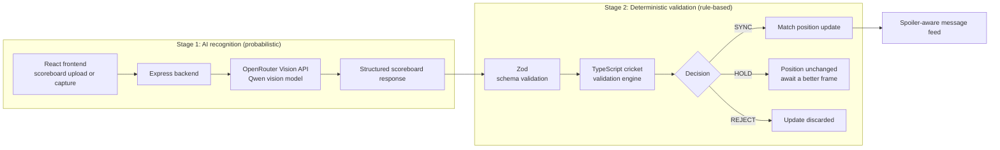
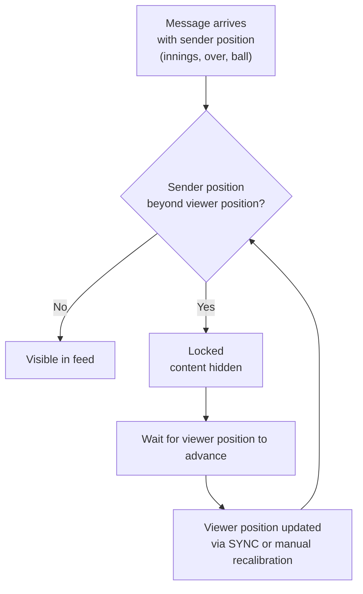

<div align="center">

# Same Second

### Your match. Your moment.

**Synchronize messages with the match, not the clock.**


An AI-assisted cricket watch-along experience that keeps group-chat messages locked until you reach the same point in the match.

> **Live demo:** _Not yet deployed. A link will be added here once the Render deployment is confirmed._
> <!-- DEPLOYED_URL_PLACEHOLDER -->

</div>

---

## Table of Contents

- [The Problem](#the-problem)
- [The Solution](#the-solution)
- [Key Features](#key-features)
- [How It Works](#how-it-works)
- [Architecture](#architecture)
- [Technology Stack](#technology-stack)
- [Project Structure](#project-structure)
- [Getting Started](#getting-started)
- [Available Scripts](#available-scripts)
- [Environment Variables](#environment-variables)
- [Validation and Testing](#validation-and-testing)
- [Deployment](#deployment)
- [Current Scope and Limitations](#current-scope-and-limitations)
- [Future Improvements](#future-improvements)
- [Contributing and Attribution](#contributing-and-attribution)
- [Closing](#closing)

---

## The Problem

Cricket fans often watch the same match through different broadcast sources and streaming platforms. Broadcast delays mean one viewer may see a wicket, a boundary or a match-changing moment before another.

During that gap, messages in group chats can spoil the moment. Messaging applications don't understand the progress of a cricket match. They deliver messages by **time**, not by **what the recipient has actually watched**.

## The Solution

Same Second is a cricket watch-along messaging experience for fans who are watching the same match at different broadcast delays.

Instead of releasing every message immediately, it compares the **match position attached to each message** with the **viewer's current match position**.

| Step | State |
|---|---|
| Sender has watched up to | Over 15.4 |
| Sender sends a message at | 15.4 |
| Receiver is currently at | 15.2 |
| Result | Message stays **locked** |
| Receiver catches up to 15.4 | Message **unlocks** |

> **Messages are synchronized with cricket progress, not wall-clock time.**

---

## Key Features

> **Important:** friend and chat activity is **simulated locally** in the current implementation. Same Second is not a production real-time multi-user chat and does not synchronize across devices.

### Match-Synchronized Messaging
- Messages carry cricket match-position metadata: **innings, over and ball**.
- Messages from ahead of the viewer's current position remain locked.
- Messages become available when the viewer catches up.

### AI-Powered Scoreboard Recognition
- Users can upload or capture a scoreboard image.
- The backend sends the image to an AI vision model through OpenRouter.
- The model interprets visible scoreboard information, identifies the current innings, and extracts the score and match position.
- Confidence and ambiguity information are returned and taken into account.

### Deterministic Cricket Validation Engine
- AI recognition is **separate** from match-state validation.
- A TypeScript validation engine checks the detected position against the existing match state.
- It evaluates confidence, match progression and ambiguity, and returns one of three outcomes: `SYNC`, `HOLD` or `REJECT`.
- Suspicious, ambiguous or implausible updates are prevented from advancing the viewer's position automatically.

### Match Progression Safety
- Handles legal-ball progression.
- Detects backward movement.
- Detects implausible jumps.
- Holds replay or ambiguous frames.
- Applies confidence thresholds and validation rules.

### Visual Match Experience
- Cricket watch-room interface.
- Scoreboard and match-progress display.
- Message feed and composer.
- Friend activity and synchronization controls.
- Manual recalibration support.
- Demo scenarios that explain spoiler prevention.

---

## How It Works

1. A user enters the watch room.
2. The viewer has a current cricket match position.
3. The user uploads or captures a scoreboard image.
4. The frontend sends the image to the Express backend.
5. The backend sends the image to the OpenRouter vision model.
6. The AI returns structured scoreboard information.
7. Zod validates the structure of the recognition response.
8. The deterministic TypeScript engine validates the detected position against the existing match state.
9. The application synchronizes, holds or rejects the update.
10. When the viewer catches up, messages associated with that position are unlocked.

### Pipeline: AI recognition and deterministic validation are separate stages



The AI only **reads** the scoreboard. It never decides whether the viewer's position changes or whether a message unlocks. That decision belongs to the deterministic engine.

### Message-unlocking flow



### Validation outcomes

| Outcome | When it applies (covered by the local tests) |
|---|---|
| `SYNC` | Legal one-ball progression from the current position |
| `HOLD` | Replay frame, low confidence, ambiguous frame, or implausible progression |
| `REJECT` | Backward movement in match position |

---

## Architecture

| Component | Responsibility |
|---|---|
| **React frontend** | User interface, watch room, scoreboard upload, match-position display, message locking |
| **Express backend** | API endpoints, image and request handling, AI API communication, serves the built frontend in production |
| **OpenRouter** | Provides access to the vision model |
| **Qwen vision model** | Interprets scoreboard images and returns structured cricket match information |
| **Zod** | Validates the structure of the model's response |
| **TypeScript validation engine** | Independently decides whether a detected position can be committed |
| **Message feed** | Uses the sender's and the viewer's cricket positions to decide message visibility |

**API key handling:** the OpenRouter API key stays on the server. It must never appear in frontend code or be committed to the repository.

---

## Technology Stack

**Frontend**
- React 19
- TypeScript
- Vite 8
- Tailwind CSS 4
- Motion
- Lucide React

**Backend**
- Node.js
- Express.js 4
- TypeScript
- tsx

**AI / Vision**
- OpenRouter API
- Qwen 3.5 Flash (`qwen/qwen3.5-flash-02-23`)
- Structured JSON response handling
- Zod for schema validation

**Build and Deployment**
- npm
- Vite
- Render Web Service
- GitHub

There is no database, authentication layer or real-time messaging backend in this implementation.

---

## Project Structure

```text
same-second/
├── public/
│   └── favicon.svg
├── src/
│   ├── components/
│   │   ├── Demo/
│   │   ├── Evaluation/
│   │   ├── WatchRoom/
│   │   ├── LandingHero.tsx
│   │   ├── MatchSetup.tsx
│   │   ├── Navbar.tsx
│   │   └── SameSecondLogo.tsx
│   ├── context/
│   │   └── WatchContext.tsx
│   ├── data/
│   │   ├── presetFrames.ts
│   │   └── sampleMatches.ts
│   ├── types/
│   │   ├── cricket.ts
│   │   ├── evaluation.ts
│   │   └── scoreboard.ts
│   ├── utils/
│   │   ├── evaluationRunner.ts
│   │   └── scoreboardMonitor.ts
│   ├── App.tsx
│   ├── index.css
│   └── main.tsx
├── server.ts
├── test-vision-recognition.ts
├── package.json
├── package-lock.json
├── tsconfig.json
├── vite.config.ts
├── .env.example
└── .gitignore
```

---

## Getting Started

### Requirements
- Node.js and npm
- An [OpenRouter](https://openrouter.ai) API key

### Install

```bash
git clone https://github.com/ItsShreena/Same_second.git
cd Same_second
npm install
```

### Configure

Copy the example file, then edit `.env` and add your key.

```bash
# Windows PowerShell
Copy-Item .env.example .env

# Windows Command Prompt
copy .env.example .env

# macOS / Linux
cp .env.example .env
```

```env
OPENROUTER_API_KEY=your_openrouter_api_key
OPENROUTER_MODEL=qwen/qwen3.5-flash-02-23
```

Make sure `.env` is listed in `.gitignore` so your key is never committed.

### Run

```bash
npm run dev
```

The Express server serves the app locally, normally at **http://localhost:3000**.

---

## Available Scripts

| Command | Purpose |
|---|---|
| `npm run dev` | Starts the Express/Vite development server |
| `npm run build` | Builds the production frontend |
| `npm run start` | Starts the Express server |
| `npm run lint` | Runs TypeScript type checking |
| `npm run test` | Runs local vision and match-validation tests |
| `npm run preview` | Runs Vite preview |

> `npm run test` runs **11 local validation tests**. It is not a full automated live-AI integration suite.

---

## Environment Variables

| Variable | Description |
|---|---|
| `OPENROUTER_API_KEY` | Secret API key used by the backend |
| `OPENROUTER_MODEL` | OpenRouter model identifier |
| `PORT` | Server port; defaults to `3000` |
| `NODE_ENV` | Set to `production` for production deployment |

Never commit real credentials.

---

## Validation and Testing

### Verified results

| Check | Result |
|---|---|
| TypeScript check (`npm run lint`) | Passed |
| Production build (`npm run build`) | Passed |
| Local tests (`npm run test`) | **11 of 11 passed** |

### What the 11 local tests cover

| # | Area |
|---|---|
| 1 | Valid live scoreboard schema |
| 2 | Unreadable scoreboard schema |
| 3 | Legal one-ball progression |
| 4 | Backward match-position rejection |
| 5 | Implausible progression `HOLD` |
| 6 | Replay `HOLD` |
| 7 | Low-confidence `HOLD` |
| 8 | Ambiguous frame `HOLD` |
| 9 | Identical thumbnail comparison |
| 10 | Changed thumbnail comparison |
| 11 | Grayscale hash consistency |

### Local tests vs. manual live-AI testing

- **Local tests** are deterministic. They exercise the schema, validation rules and thumbnail utilities without calling the AI model.
- **Manual live-AI testing:** a manual scoreboard-upload test extracted an example match position, displayed the confidence, applied the update, and unlocked a message once the viewer caught up. This was a manual check on an example, **not** an automated suite and not a measurement of recognition accuracy.

No accuracy figures are claimed for the vision model.

---

## Deployment

Same Second is designed to deploy as **one Render Node.js Web Service**, because the Express backend serves the built React frontend.

| Setting | Value |
|---|---|
| Repository | `ItsShreena/Same_second` |
| Branch | `main` |
| Runtime | Node |
| Build command | `npm install && npm run build` |
| Start command | `npm run start` |

**Environment variables on Render**

```text
OPENROUTER_API_KEY=<your key, set in the Render dashboard>
OPENROUTER_MODEL=qwen/qwen3.5-flash-02-23
NODE_ENV=production
```

The server reads Render's `PORT` environment variable and listens on `0.0.0.0`.

**Deployed application:** _placeholder. Add the URL here after the Render deployment is confirmed._

---

## Current Scope and Limitations

This is a prototype demonstrating match-aware spoiler prevention, not a production cricket data service.

- Friend and chat interactions are **simulated locally**.
- There is **no production multi-user messaging backend**.
- There is **no cross-device synchronization**.
- The system depends on **readable scoreboard images** and on the availability of an external AI API.
- Uploaded scoreboard images are sent to a third-party AI service through OpenRouter.
- AI recognition can be uncertain. Deterministic validation adds a safety layer but **does not guarantee zero errors**.
- Same Second **does not intercept or integrate with** WhatsApp, Instagram, Telegram, SMS or other messaging platforms.

---

## Future Improvements

These are possibilities, not existing features.

- Real-time multi-user chat
- Shared watch rooms and cross-device synchronization
- Integration with official cricket data providers
- Improved innings and scoreboard recognition across broadcast layouts
- More extensive automated vision testing
- Better support for different cricket formats and tournament scoreboards
- User accounts and persistent match sessions

---

## Contributing and Attribution

Same Second is a hackathon prototype built for the Dream11 FDE challenge. Issues and suggestions are welcome through [GitHub Issues](https://github.com/ItsShreena/Same_second/issues).

- **License:** no license has been specified yet. Add a `LICENSE` file before any reuse or redistribution.
- **AI-assisted development:** Google AI Studio, ChatGPT, Claude and NotebookLM were used for planning, prototyping, review and note-keeping.

---

## Closing

Same Second rethinks how fans experience group conversations during live cricket. By connecting message visibility to actual match progress rather than time, it aims to make watching together feel synchronized, even when broadcasts are not.
